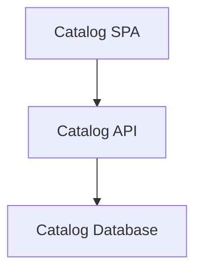
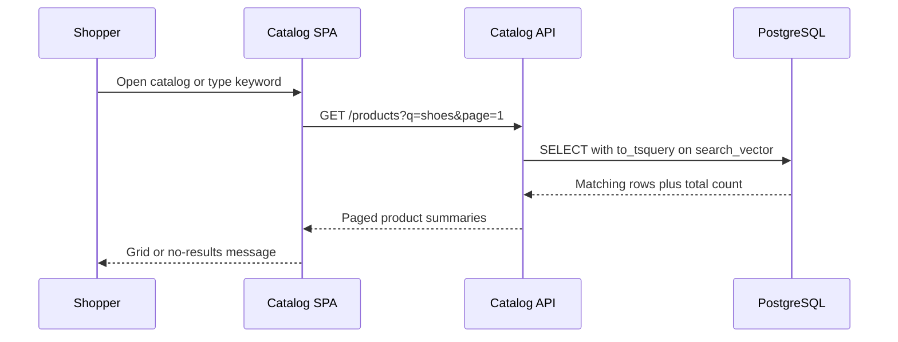
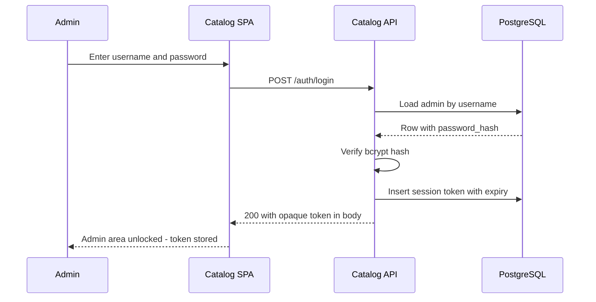
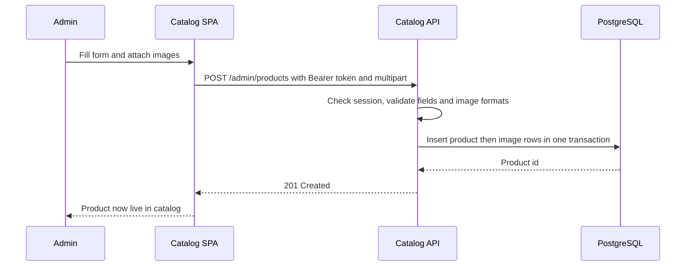
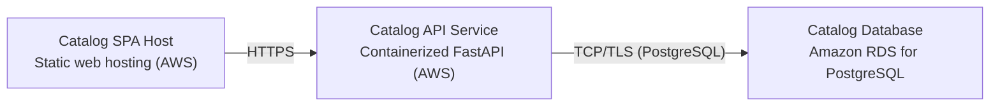

# Architecture

> Maintained by QuorQ AI SDLC. Text between `sdlc:auto` markers is regenerated; anything outside them is yours and is kept.

<!-- sdlc:auto:start narrative -->
## Overview

### ARCH-001 · approved · source: architecture:summary

Overall architecture (v1, approved) for a lightweight public product catalog with no accounts/personal data collection, built on React 19, FastAPI 0.115, and PostgreSQL 16.

Shoppers browse a paginated product grid, open detail pages with image galleries and single-currency pricing, optionally follow an outbound link, and search by keyword via PostgreSQL full-text search. Staff sign in to a password-protected admin area to add, edit, and remove products and manage product images. Amazon S3 was removed from the stack; uploaded images are stored as binary rows in PostgreSQL and streamed back through the API, keeping the system to one data store. Authentication uses server-side sessions with an opaque bearer token (SPA and API are on separate origins); sessions end on sign-out or after inactivity.

### COMP-web · approved · source: architecture:component:web

Catalog SPA (React 19): the responsive front end for both shoppers and admin staff.

Serves the public product grid, detail pages, and keyword search, plus the password-protected admin screens for product and image management. Reads the API base URL from VITE_API_BASE_URL and sends Authorization: Bearer on admin calls.

**Related:** COMP-api

### COMP-api · approved · source: architecture:component:api

Catalog API (FastAPI 0.115): the backend service exposing public read endpoints and authenticated admin endpoints.

Exposes public list/search, detail, and image-streaming endpoints, plus authenticated admin endpoints for product CRUD, image upload/removal, and login/logout. Runs full-text search queries, validates uploads, hashes admin passwords, and manages opaque session tokens with inactivity expiry.

**Related:** COMP-web, COMP-db

### COMP-db · approved · source: architecture:component:db

Catalog Database (PostgreSQL 16): the single data store for products, images, credentials, and sessions.

Stores products, product images as binary rows (S3 was removed from the stack), admin credentials in hashed form, and server-side sessions. Provides built-in full-text search for the keyword search box.

**Related:** COMP-api

### CP-browse-search · approved · source: architecture:critical_path:Browse and keyword search

Describes how shoppers browse the catalog and search by keyword.

Shopper opens the catalog and optionally types a keyword. The SPA requests a paginated page of products; the API runs a PostgreSQL full-text query over name and description when a keyword is present, otherwise returns the full list ordered by recency. Empty catalog and no-match both return an empty list, which the SPA renders as a friendly message.

**Related:** COMP-web, COMP-api, COMP-db

### CP-admin-login · approved · source: architecture:critical_path:Admin sign-in with session token

Describes staff sign-in and server-side session/token issuance.

Staff submit credentials. The API verifies the username and bcrypt-hashed password; on success it creates a session row with an opaque token and expiry, returning the token in the response body. The SPA stores the token and sends it as a bearer token on subsequent admin calls. Invalid credentials return a generic 401 that does not reveal which field was wrong.

**Related:** COMP-web, COMP-api, COMP-db

### CP-add-product · approved · source: architecture:critical_path:Add product with image upload

Describes how an authenticated admin adds a product with one or more images.

Authenticated admin submits a product plus one or more image files as multipart form data. The API validates required fields, validates each file is a supported image via Pillow, and stores the product and image binaries in PostgreSQL in one transaction. The product becomes publicly visible immediately.

**Related:** COMP-web, COMP-api, COMP-db

### DATA-MODEL · approved · source: architecture:entities

Four core tables back the catalog: products, product_images, admin_users, and admin_sessions.

products: id, name, description, price, currency, outbound_link, search_vector, created_at, updated_at. product_images: id, product_id, content, content_type, filename, sort_order, created_at (binary image storage, since S3 was removed from scope). admin_users: id, username, password_hash, created_at. admin_sessions: token, admin_user_id, created_at, last_active_at, expires_at.

**Related:** COMP-db

### API-ENDPOINTS · approved · source: architecture:endpoints

Ten REST endpoints cover public catalog browsing/search, admin authentication, and admin product/image CRUD.

Public: GET /products (paginated list with optional keyword search over name/description; empty catalog or no match returns an empty page rendered as a message by the SPA); GET /products/{id} (full detail including image ids, single-currency price, optional outbound link); GET /products/{id}/images/{image_id} (streams stored image binary with content type). Auth: POST /auth/login (verifies credentials, creates server-side session, returns opaque token; generic error on failure); POST /auth/logout (revokes current session token). Admin CRUD: POST /admin/products (create with name, description, price, optional outbound link, one or more image files; validates required fields and supported image formats); PUT /admin/products/{id} (updates fields; clearing a required field is rejected and previous values retained); DELETE /admin/products/{id} (removes product and its images so it disappears from list/search/detail; SPA confirms before calling); POST /admin/products/{id}/images (uploads additional images; unsupported files rejected with accepted formats); DELETE /admin/products/{id}/images/{image_id} (removes a single image, retaining the rest).

**Related:** COMP-api, DATA-MODEL

### DEPLOY-NODES · approved · source: architecture:deployment_nodes

Three deployment nodes on AWS host the SPA, API, and database.

Catalog SPA Host: static web hosting (AWS), serving the React 19 build as static assets. Catalog API Service: containerized FastAPI (AWS), Python 3.12 / FastAPI 0.115 under uvicorn. Catalog Database: Amazon RDS for PostgreSQL, PostgreSQL 16.

**Related:** COMP-web, COMP-api, COMP-db

### TECH-frontend · approved · source: architecture:technology:Frontend

Frontend technology choice: React 19 over Vue or Svelte.

React 19 builds the responsive, image-led product grid, detail gallery, and admin forms as a single SPA served from its own static origin. It reads the API base URL from VITE_API_BASE_URL and sends a bearer token on admin calls. Alternatives considered: Vue, Svelte.

**Related:** COMP-web

### TECH-backend · approved · source: architecture:technology:Backend

Backend technology choice: FastAPI 0.115 over Flask or Django.

FastAPI serves the public list/search/detail/image endpoints and authenticated admin CRUD with multipart uploads with little ceremony, and streams image bytes straight from PostgreSQL. Alternatives considered: Flask, Django.

**Related:** COMP-api

### TECH-database · approved · source: architecture:technology:Database

Database technology choice: PostgreSQL 16 over MySQL or SQLite.

PostgreSQL 16 holds structured product data, hashed admin credentials, and sessions; provides built-in full-text search (tsvector/GIN) for the keyword box; and stores image binaries as bytea since object storage (S3) was removed from scope. Alternatives considered: MySQL, SQLite.

**Related:** COMP-db, DATA-MODEL

### TECH-cloud · approved · source: architecture:technology:Cloud

Cloud platform choice: AWS over GCP or Azure.

AWS hosts the static SPA, the FastAPI container, and managed PostgreSQL (RDS) in one account. No S3 is used because file storage was removed from scope. Alternatives considered: GCP, Azure.

**Related:** COMP-web, COMP-api, COMP-db, DEPLOY-NODES
<!-- sdlc:auto:end narrative -->

<!-- sdlc:auto:start building-blocks -->
## Building Block View

| ID | Name | Technology | Responsibility | Depends on |
|---|---|---|---|---|
| web | Catalog SPA | React 19 | Responsive React app serving the public product grid, detail pages, keyword search, and the password-protected admin screens for product and image management. Reads API base URL from VITE_API_BASE_URL and sends Authorization: Bearer on admin calls. | api |
| api | Catalog API | FastAPI 0.115 | FastAPI service exposing public read endpoints (list/search, detail, image streaming) and authenticated admin endpoints (CRUD products, upload/remove images, login/logout). Runs full-text search, validates uploads, hashes admin passwords, and manages opaque session tokens with inactivity expiry. | db |
| db | Catalog Database | PostgreSQL 16 | PostgreSQL storing products, product images as binary rows (S3 removed from stack), admin credentials in hashed form, and server-side sessions. Provides built-in full-text search for the keyword search box. | — |

<!-- sdlc:auto:end building-blocks -->

<!-- sdlc:auto:start runtime -->
## Runtime View

### Browse and keyword search

Shopper opens the catalog and optionally types a keyword. The SPA requests a paginated page of products; the API runs a PostgreSQL full-text query over name and description when a keyword is present, otherwise returns the full list ordered by recency. Empty catalog and no-match both return an empty list the SPA renders as a friendly message.

- **Components:** web, api, db
- **Modules:** products_router, product_repository, search_service
- **Key functions:** list_products(q, page, page_size), build_fts_query(q), to_product_summary(row)

### Admin sign-in with session token

Staff submit credentials. The API verifies the username and bcrypt-hashed password, and on success creates a session row with an opaque token and expiry, returning the token in the response body. The SPA stores it and sends it as a bearer token. Invalid credentials return a generic 401 that does not reveal which field was wrong.

- **Components:** web, api, db
- **Modules:** auth_router, session_service, password_hasher
- **Key functions:** login(username, password), verify_password(raw, hash), create_session(admin_id), require_session(token)

### Add product with image upload

Authenticated admin submits a product plus one or more image files as multipart form data. The API validates required fields, validates each file is a supported image via Pillow, stores the product and image binaries in PostgreSQL in one transaction, and the product becomes publicly visible immediately.

- **Components:** web, api, db
- **Modules:** admin_products_router, product_service, image_validator
- **Key functions:** create_product(payload, files, session), validate_image(file), store_image(product_id, bytes, content_type)

<!-- sdlc:auto:end runtime -->

<!-- sdlc:auto:start deployment-view -->
## Deployment View

| Name | Service | Runtime | Scaling | Environment |
|---|---|---|---|---|
| Catalog SPA Host | Static web hosting (AWS) | React 19 build served as static assets | CDN-fronted static, no app scaling | dev |
| Catalog API Service | Containerized FastAPI (AWS) | Python 3.12 / FastAPI 0.115 under uvicorn | 1 container in dev, horizontal later | dev |
| Catalog Database | Amazon RDS for PostgreSQL | PostgreSQL 16 | Single instance in dev | dev |

| Source | Target | Protocol |
|---|---|---|
| Catalog SPA Host | Catalog API Service | HTTPS |
| Catalog API Service | Catalog Database | TCP/TLS (PostgreSQL) |

<!-- sdlc:auto:end deployment-view -->

<!-- sdlc:auto:start decisions -->
## Architecture Decisions

| Layer | Choice | ADR |
|---|---|---|
| Frontend | React 19 | [ADR-0001](adr/frontend.md) |
| Backend | FastAPI 0.115 | [ADR-0002](adr/backend.md) |
| Database | PostgreSQL 16 | [ADR-0003](adr/database.md) |
| Cloud | AWS | [ADR-0004](adr/cloud.md) |
<!-- sdlc:auto:end decisions -->

<!-- sdlc:auto:start links -->
## Related Documents

- [Data Model](data-model.md)
- [API Specification](api/openapi.yaml)
- [Architecture Decision Records](adr/README.md)
<!-- sdlc:auto:end links -->
