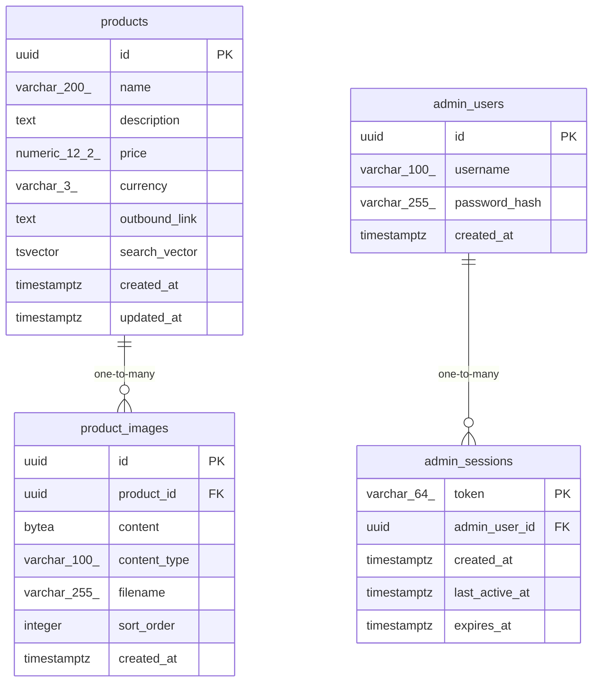

# Data Model

<!-- sdlc:auto:start entities -->
### products

| Field | Type | PK | FK | Nullable |
|---|---|---|---|---|
| id | uuid | True | — | False |
| name | varchar(200) | False | — | False |
| description | text | False | — | True |
| price | numeric(12,2) | False | — | False |
| currency | varchar(3) | False | — | False |
| outbound_link | text | False | — | True |
| search_vector | tsvector | False | — | True |
| created_at | timestamptz | False | — | False |
| updated_at | timestamptz | False | — | False |

### product_images

| Field | Type | PK | FK | Nullable |
|---|---|---|---|---|
| id | uuid | True | — | False |
| product_id | uuid | False | products.id | False |
| content | bytea | False | — | False |
| content_type | varchar(100) | False | — | False |
| filename | varchar(255) | False | — | True |
| sort_order | integer | False | — | False |
| created_at | timestamptz | False | — | False |

### admin_users

| Field | Type | PK | FK | Nullable |
|---|---|---|---|---|
| id | uuid | True | — | False |
| username | varchar(100) | False | — | False |
| password_hash | varchar(255) | False | — | False |
| created_at | timestamptz | False | — | False |

### admin_sessions

| Field | Type | PK | FK | Nullable |
|---|---|---|---|---|
| token | varchar(64) | True | — | False |
| admin_user_id | uuid | False | admin_users.id | False |
| created_at | timestamptz | False | — | False |
| last_active_at | timestamptz | False | — | False |
| expires_at | timestamptz | False | — | False |
<!-- sdlc:auto:end entities -->

<!-- sdlc:auto:start relationships -->
| Source | Target | Type |
|---|---|---|
| products | product_images | one-to-many |
| admin_users | admin_sessions | one-to-many |
<!-- sdlc:auto:end relationships -->

<!-- sdlc:auto:start er-diagram -->

<!-- sdlc:auto:end er-diagram -->
